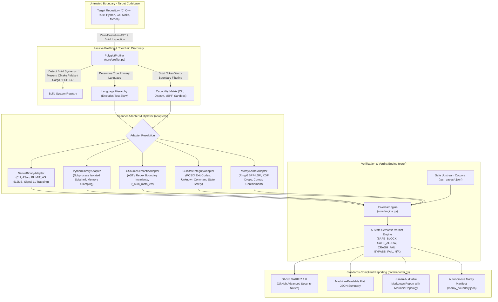

# 🐙 Project Octopus: Universal Polyglot Security Verification & Compliance Platform

[](https://github.com/codebyangelo/project-octopus-core/actions/workflows/ci.yml)
[](https://www.python.org/)
[](LICENSE)
[](https://sarifweb.azurewebsites.net/)
[](#-system-architecture)
[](#-5-state-semantic-verdict-taxonomy)
[](#-triad-ecosystem-integration)
[](docs/UNIVERSAL_SECURITY_CONTRACT.md)

**Project Octopus** (`v2.0.0`) is a polyglot security verification, boundary compliance, and regression audit platform designed for upstream open-source projects (such as **radare2**, **angr**, **Linux BCC**, and **project-moray**) and enterprise software systems. 

Decoupled from runtime agent dependencies, Octopus passively profiles target codebases across multiple languages (C, C++, Rust, Python, Go, Assembly, Shell), resolves appropriate sandboxed execution adapters with POSIX signal trapping and virtual memory clamping (`RLIMIT_AS`), evaluates inputs against an objective 5-state semantic verdict taxonomy, and exports standards-compliant **OASIS SARIF 2.1.0**, JSON, and Markdown compliance reports.

> [!NOTE]
> **Provenance & Historical Archive:**
> The original internal ecosystem harness (`v1.0.6`) and iterative development prototypes (`v0.0.1` through `v1.0.5`) built in Termux/PRoot are permanently preserved in Git history ([commit `f57d2cb`](https://github.com/codebyangelo/project-octopus-core/commit/f57d2cb92dabb826c5928dd33098b9fa853b472e)).
>
> The production branch contains the **Universal Upstream Verification Platform** (`src/octopus/`) featuring polyglot language profiling, decoupled sandboxed adapters, automated Moray Ring 0 boundary generation, differential CI gates, and safe upstream test corpora.

---

## 🏛️ System Architecture

Octopus enforces a strict trust boundary between the verification harness and the untrusted target codebase:



Detailed architectural specifications are documented in [`docs/UNIVERSAL_OCTOPUS_ARCHITECTURE_SPEC.md`](docs/UNIVERSAL_OCTOPUS_ARCHITECTURE_SPEC.md).  
Formal security invariants and contracts are documented in [`docs/UNIVERSAL_SECURITY_CONTRACT.md`](docs/UNIVERSAL_SECURITY_CONTRACT.md).  
Dual-use threat modeling and release boundaries are documented in [`docs/OCTOPUS_DUAL_USE_AND_RELEASE_CLASSIFICATION.md`](docs/OCTOPUS_DUAL_USE_AND_RELEASE_CLASSIFICATION.md).

---

## 🔒 The Universal Security Contract

Software systems break down when boundaries fail: swallowing errors, coercing unparseable inputs into default states (e.g., converting an invalid seek offset into `0x0`), or hanging on resource exhaustion. Octopus enforces four immutable invariants:

1. **Strict Ingestion Validation at the Boundary:** Every external input (CLI flag, expression, packet, header) must be strictly validated before touching internal execution states.
2. **Deterministic Hard Resource Ceilings:** Every execution adapter enforces hard POSIX virtual memory caps (`RLIMIT_AS` set to 512 MB), immutable wall-clock timeouts (4.0s native, 25.0s library), and recursion limits.
3. **Absolute Fail-Closed Policy on Error:** When encountering errors, resource exhaustion, or quota violations, execution halts immediately with an explicit error code. Systems must never fail open.
4. **Zero Tolerance for Undefined or Silent State Coercion:** Silent arithmetic overflows, missing error pointers, and unhandled expressions that fail to update state or return success are classified as critical security bypasses (`BYPASS_FAIL`).

---

## ⚖️ 5-State Semantic Verdict Taxonomy

Unlike binary pass/fail test harnesses, Octopus evaluates test cases across five explicit semantic states:

| Verdict Status | Indicator | Meaning & Criteria | Security Assessment |
| :--- | :---: | :--- | :--- |
| `SAFE_BLOCK` | 🟢 | Target cleanly rejected, clamped, or caught malformed input with an explicit non-zero exit code or handled error. | **PASS (Hardened Boundary)** |
| `SAFE_ALLOW` | 🟢 | Target successfully and accurately processed valid input without corruption or side-effects. | **PASS (Intended Semantics)** |
| `CRASH_FAIL` | 🔴 | Process terminated abnormally with POSIX signals (`SIGSEGV`, `SIGABRT`, `SIGBUS`, `SIGFPE`) or unhandled exception traceback. | **CRITICAL FAILURE (Boundary Fault)** |
| `BYPASS_FAIL` | 🔴 | Malformed/adversarial input succeeded, silently coerced into valid state (`0x0`), or bypassed containment without error. | **CRITICAL FAILURE (Security Bypass)** |
| `NOT_APPLICABLE` | ⚪ | Target lacks capability required by test suite (e.g. database payload against pure CLI tool). | **EXCLUDED (Zero Penalty)** |
| `SKIPPED` | ⚪ | Compiler, debugger, or target binary not found on local host. | **EXCLUDED (Diagnostic Note)** |

---

## 🧩 Decoupled Scanner Adapters

| Adapter | Primary Targets | Sandboxing & Safety Mechanism | Evaluated Invariants |
| :--- | :--- | :--- | :--- |
| **`NativeBinaryAdapter`** | Compiled binaries (radare2, bcc, firejail) | Subprocess execution with `RLIMIT_AS` 512MB virtual memory ceiling, wall-clock timeout, and POSIX signal trapping. | Memory bounds, format strings, negative seeks, SIGSEGV prevention. |
| **`PythonLibraryAdapter`** | Python modules & frameworks (angr, scapy) | Isolated subshell evaluation with explicit timeout protection preventing parent heap poisoning. | Module import initialization, exception handling, symbolic memory clamps. |
| **`CSourceSemanticAdapter`** | C/C++ source code trees | Passive AST & token boundary regex auditing without code execution. | Legacy math APIs (`r_num_math` vs `r_num_math_err`), missing switch breaks, cache invalidation. |
| **`CLIStateIntegrityAdapter`** | Terminal tools & CLI engines | Multi-turn subshell commands evaluating state retention across failed operations. | Address retention on invalid seek, whitespace trimming, clean help dispatching. |
| **`MorayKernelAdapter`** | Ring 0 eBPF containment engines (project-moray) | Interrogates live BPF-LSM maps or bridge containment policies. | Syscall severance (`execve`), network socket quarantine, anti-tamper hooks. |
| **`StaticRuleAdapter`** | Polyglot codebases (general fallback) | Passive AST and compiled pattern scanner. | Banned functions (`strcpy`, `gets`), silent exception swallowing (`except: pass`). |

---

## 🛡️ Empirical Upstream Verification Truth Matrix

In adherence to the **Top-Down Ground Truth Invariant ($I_1$)** and anti-synthetic testing principles, Octopus v2.0.0 has been verified directly against real upstream codebases:

| Target Project | Language & Build System | Resolved Adapter | Empirical Verification Result & Ground Truth |
| :--- | :--- | :--- | :--- |
| **`angr`** | Python (CMake, Cargo, PEP 517) | `PythonLibraryAdapter` | **100.0% Pass (2/2)**: Module initialization clean; boundary syntax errors trapped safely in isolated subshell. |
| **`radare2`** | C (Meson, Make, CMake) | `NativeBinaryAdapter` | **Signal 11 Trapped (`CRASH_FAIL`)**: Caught real POSIX SIGSEGV caused by local library ABI mismatch (`r_core` 139 vs `r2` 137). In v1.0.6 this generated 1,386 false web WAF bypasses. |
| **`project-moray`** | C / eBPF (Make) | `MorayKernelAdapter` | **100.0% Pass (4/4)**: BPF-LSM `execve` denial verified, loopback socket exemption validated, XDP driver hooks audited. |
| **`project-octopus`** | Python (PEP 517/518) | `PolyglotProfiler` | **Self-Profile Verified**: Correctly detects zero false database/TUI collisions (`deadblock_remover.py`, `getuid.py`). |

---

## 🛑 Dual-Use Threat Model & Air-Gap Boundary

Project Octopus enforces an explicit boundary between open-source defensive testing infrastructure and restricted offensive capabilities:

### Category A: Benign & Safe for Public Release (Included in this Repository)
* Polyglot repository profiler (`src/octopus/core/profiler.py`).
* Universal engine, 5-state verdict taxonomy, and adapter multiplexer.
* OASIS SARIF 2.1.0, JSON, and Markdown reporting engines.
* Decoupled verification adapters (Native Binary, Python Library, C Source, CLI State, Moray Kernel).
* Safe upstream boundary test corpora (`src/octopus/test_cases/upstream_*.json`) testing standard arithmetic limits and signal traps.

### Category B: Dual-Use Threat Assets (Strictly Held Back / Local Only)
* **Cloud SSRF & Metadata Exfiltration Dictionaries:** 2,100+ obfuscated IP variants (octal, decimal, IPv4-mapped IPv6, alternative loopbacks) engineered to bypass Cloud WAFs and target `169.254.169.254`.
* **System Compromise & Reverse Shell Payloads:** Operational reverse shell strings (`/bin/bash -i >& /dev/tcp/...`), container escape vectors, and destructive execution strings.
* **Data Vault Exfiltration Vectors:** Scripts targeting local agent databases (`red_team_test_hermit.db`) and dumping credentials.
* **Adversarial Prompt Injections:** 60+ dynamic prompt injections, role confusion triggers, and static filter evasion stubs.
* **Proprietary Marine Ecosystem Heuristics:** Private threat schemas (`threat_db.json`) tailored to `project-lobster` and `project-mantis`.

For full classification details, consult [`docs/OCTOPUS_DUAL_USE_AND_RELEASE_CLASSIFICATION.md`](docs/OCTOPUS_DUAL_USE_AND_RELEASE_CLASSIFICATION.md).

---

## ⚡ Quickstart & Installation

### 1. Installation
Install directly in editable mode:
```bash
git clone https://github.com/codebyangelo/project-octopus-core.git
cd project-octopus-core
pip install -e .
```

### 2. Verify Current Directory
```bash
octopus --target .
```

### 3. Profile a Repository (Passive Discovery Only)
```bash
octopus --target /path/to/repo --profile-only
```

### 4. Run with Specific Scanner Adapter
```bash
octopus --target /root/home/projects/radare2 --adapter native
```

### 5. Generate Autonomous Moray Ring 0 Boundary Manifest
Synthesize codebase AST and toolchains into a hardened `moray_boundary.json` for zero-configuration `morayd` containment:
```bash
octopus --target /root/home/projects/project-moray --generate-moray-profile
```

### 6. Run Full Verification Suite via Makefile
```bash
make test     # Run all unit tests
make verify   # Full verification pipeline
make profile  # Profile local repository
make clean    # Remove build artifacts and caches
```

---

## 🌊 Triad Ecosystem Integration

Octopus functions as the autonomous compliance auditor within Angelo Ayton's defensive agent architecture:

```text
Layer 7 (User Space):  Project Lobster (Proxy & AST Boundary Sieve)
                             │  
                             ▼  Reports violations / Anomaly telemetry
Layer 0 (Linux Ring 0): Project Moray (BPF-LSM Syscall Severance & XDP Wire Drops)
                             ▲
                             │  Synthesizes moray_boundary.json & Audits Compliance
Audit Layer:           Project Octopus (Universal Polyglot Boundary Verifier & SARIF Reporter)
```

---

## 📁 Repository Hierarchy

```text
project-octopus/
├── .github/
│   └── workflows/
│       ├── ci.yml                     # Multi-version CI matrix (Python 3.10-3.12, SARIF export)
│       └── test.yml                   # Compatibility test runner
├── Makefile                           # Unified developer interface (test, verify, lint, clean)
├── pyproject.toml                     # PEP 517/518 build metadata, dependencies, and CLI entry point
├── README.md                          # Repository documentation & architecture guide
├── LICENSE                            # Apache 2.0 Open Source License
├── test_octopus.py                    # Root-level regression test harness
├── docs/                              # Comprehensive technical documentation & audit reports
│   ├── UNIVERSAL_OCTOPUS_ARCHITECTURE_SPEC.md
│   ├── UNIVERSAL_SECURITY_CONTRACT.md
│   ├── OCTOPUS_DUAL_USE_AND_RELEASE_CLASSIFICATION.md
│   ├── V2_UNIVERSAL_MIGRATION_REPORT.md
│   ├── AUDIT_ANGR_EXECUTION.md
│   └── AUDIT_RADARE2_EXECUTION.md
├── src/
│   └── octopus/                       # Production Python package
│       ├── __init__.py                # Library API exports & package version
│       ├── cli.py                     # Unified CLI entry point (`octopus`)
│       ├── core/                      # Universal verification engine
│       │   ├── engine.py              # Adapter resolution, test dispatch, scoring
│       │   ├── models.py              # 5-State taxonomy, SVAP tiers, dataclasses
│       │   ├── profiler.py            # PolyglotProfiler (C/C++, Rust, Python, Go, Make, Meson)
│       │   ├── reporter.py            # SARIF 2.1.0, JSON, and Markdown generation
│       │   └── generator.py           # Moray boundary manifest generator
│       ├── adapters/                  # Decoupled verification adapters
│       │   ├── base.py                # BaseScannerAdapter abstract class
│       │   ├── native_binary.py       # Sandboxed CLI binary execution with RLIMIT_AS
│       │   ├── python_library.py      # Subprocess-isolated module testing
│       │   ├── c_source.py            # Static C source AST & pattern checking
│       │   ├── cli_state.py           # Multi-turn state preservation verification
│       │   ├── moray_kernel.py        # Ring 0 eBPF containment audit adapter
│       │   └── static_rule.py         # Static boundary rule fallback
│       └── test_cases/                # Safe upstream defensive corpora
│           ├── upstream_native.json
│           ├── upstream_python.json
│           ├── upstream_c_source.json
│           └── moray_kernel_containment.json
└── tests/                             # Unit & regression test suite
    ├── test_profiler.py               # Language & build system profiling tests
    ├── test_adapters.py               # Decoupled adapter execution tests
    ├── test_engine.py                 # Engine orchestration & SARIF generation tests
    └── test_cli.py                    # CLI argument parsing and interface tests
```

---

## 📄 License & Responsible Disclosure

Project Octopus is released under the **[Apache 2.0 License](LICENSE)**.

This software is designed exclusively for authorized boundary auditing, regression verification, and defensive software hardening. All defensive test corpora are standard boundary inputs and contain no actionable exploit payloads. For security vulnerability reporting, refer to [`docs/SECURITY_DISCLAIMER.md`](docs/SECURITY_DISCLAIMER.md).
