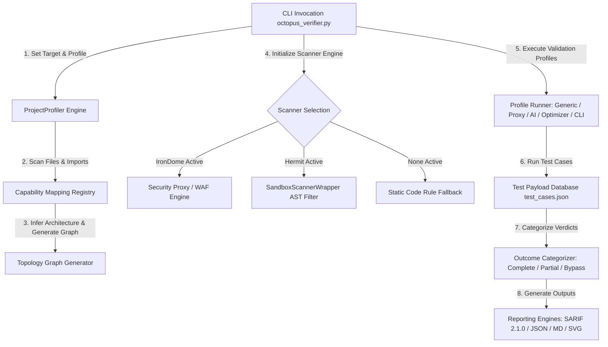

# 🐙 Project Octopus

[](https://github.com/codebyangelo/project-octopus-core/actions/workflows/test.yml)
[](LICENSE)
[](https://www.python.org/)
[](https://sarifweb.azurewebsites.net/)
[-brightgreen.svg)](docs/READINESS_SCORE.md)

**Project Octopus** (`v1.0.6`) is an agnostic security verification, compliance profiling, and defensive regression testing platform. It provides automated, profile-based verification of target software systems across 8 validation domains (`generic`, `security_proxy`, `ai_agent`, `optimizer`, `dfir`, `cli`, `rest_api`, `plugin_framework`). 

Octopus dynamically inspects a target codebase, maps its capabilities, hooks into active or fallback scanner interfaces (such as WAF firewalls or sandbox AST code safety analyzers), and generates machine-readable SARIF 2.1.0, JSON, Markdown, and SVG compliance badge reports.

---

## 🤖 Human-AI Engineering & Development Environment

Project Octopus was architected and documented through a pair-engineering collaboration between the human developer and **Google Antigravity CLI**, operating entirely on ARM mobile hardware:

* **Hardware Environment**: Developed and verified on a **Samsung Galaxy A36** mobile smartphone.
* **OS & Subsystem**: Executed within **Termux** inside a **PRoot** Linux environment.
* **Collaborative AI Agent**: **Google Antigravity CLI** assisted with automated codebase profiling, AST fallback wrapper design, SARIF 2.1.0 schema generation, and repository documentation reconstruction.

> [!NOTE]
> **Defense-First & Responsible Disclosure Policy**: Project Octopus is strictly a defensive security verifier. All documentation and verification suites adhere to responsible disclosure guidelines (`docs/SECURITY_DISCLAIMER.md`) and omit actionable zero-day exploit payloads.

---

## 🏛️ System Architecture & Capability Topology



---

## 🚀 Quick Start Guide

### 1. List All Available Validation Profiles
```bash
python3 v1.0.6/octopus_verifier.py --list-profiles
```

### 2. Verify Target Repository with Auto-Profile Matching
```bash
python3 v1.0.6/octopus_verifier.py --target /path/to/target/repository
```

### 3. Run Specific Validation Profiles
```bash
python3 v1.0.6/octopus_verifier.py --target /path/to/target/repository --profile generic,optimizer
```

---

## 📂 Documentation Sitemap & Deliverables Index

All detailed architecture, security models, performance benchmarks, and verification taxonomies are available in the [`docs/`](docs/) directory:

| Document | Purpose / Summary |
| :--- | :--- |
| **[docs/PROJECT_MANIFEST.md](docs/PROJECT_MANIFEST.md)** | Inventory manifest, technology stack, and directory hierarchy. |
| **[docs/PROJECT_OVERVIEW.md](docs/PROJECT_OVERVIEW.md)** | Purpose, problem statement, engineering goals, and non-goals. |
| **[docs/ARCHITECTURE.md](docs/ARCHITECTURE.md)** | System architecture, execution lifecycle, and fallback sandbox wrappers. |
| **[docs/HISTORY.md](docs/HISTORY.md)** | Chronological history across 106 release versions (`v0.0.1` to `v1.0.6`). |
| **[docs/DESIGN_DECISIONS.md](docs/DESIGN_DECISIONS.md)** | Architectural trade-offs, profile choices, and rejected design options. |
| **[docs/FEATURES.md](docs/FEATURES.md)** | Platform features catalog and 8 Validation Profile descriptions. |
| **[docs/INSTALL.md](docs/INSTALL.md)** | Prerequisites, Python virtual environment, and Termux/PRoot setup. |
| **[docs/USAGE.md](docs/USAGE.md)** | Detailed developer operations guide and CLI command-line reference. |
| **[docs/API.md](docs/API.md)** | Python class reference (`ProjectProfiler`, `SandboxScannerWrapper`) and method signatures. |
| **[docs/CONFIGURATION.md](docs/CONFIGURATION.md)** | Parameter references, validation profile JSON schemas, and report paths. |
| **[docs/SECURITY.md](docs/SECURITY.md)** | Security architecture, threat model, and taxonomy standards mapping (OWASP, MITRE). |
| **[docs/PERFORMANCE.md](docs/PERFORMANCE.md)** | Empirical benchmarks, profile filtering gains, and Termux/PRoot mobile footprint. |
| **[docs/TESTING.md](docs/TESTING.md)** | Testing strategy, 14 syntax template encoders, and verdict outcome categorization. |
| **[docs/RESEARCH.md](docs/RESEARCH.md)** | Standards research ledgers, experimental hypotheses, and conclusions. |
| **[docs/LIMITATIONS.md](docs/LIMITATIONS.md)** | Technical debt, static import graph limitations, and unsupported features. |
| **[docs/PROJECT_STATUS.md](docs/PROJECT_STATUS.md)** | Active development focus, research questions, and system priorities. |
| **[docs/NEXT_STEPS.md](docs/NEXT_STEPS.md)** | Evidence-based future roadmap (multi-language AST parsers, real-time SARIF streaming). |
| **[docs/CHANGELOG.md](docs/CHANGELOG.md)** | Version release notes from `v0.5.0` through `v1.0.6`. |
| **[docs/CONTRIBUTING.md](docs/CONTRIBUTING.md)** | Contribution guidelines, defense-first scope policy, and pull request steps. |
| **[docs/CODE_OF_CONDUCT.md](docs/CODE_OF_CONDUCT.md)** | Community standards and defensive research conduct rules. |
| **[docs/SECURITY_DISCLAIMER.md](docs/SECURITY_DISCLAIMER.md)** | Security and responsible disclosure disclaimer. |
| **[LINKEDIN_TOPICS.md](docs/LINKEDIN_TOPICS.md)** | Public-facing post concepts, hooks, problem/solution breakdowns, and LinkedIn posting schedule. |
| **[ARTICLE_OUTLINES.md](docs/ARTICLE_OUTLINES.md)** | Technical long-form article outlines on agnostic security verification and AST fallback scanning. |
| **[PORTFOLIO_HIGHLIGHTS.md](docs/PORTFOLIO_HIGHLIGHTS.md)** | Executive engineering highlights and core technical accomplishments. |
| **[INTERVIEW_TALKING_POINTS.md](docs/INTERVIEW_TALKING_POINTS.md)** | Resume bullet candidates and technical interview discussion topics. |

---

## 📜 License

Project Octopus is open-source software licensed under the **[Apache License 2.0](LICENSE)**.
