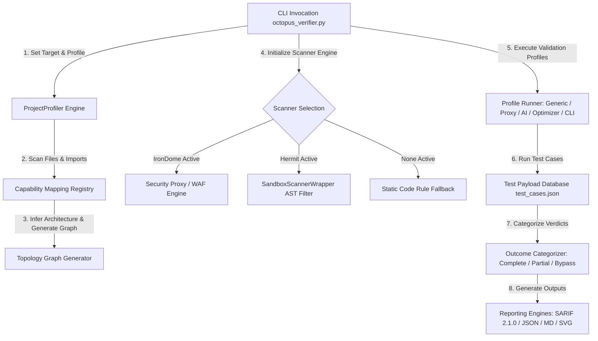

# ARCHITECTURE.md
## Phase 2 - System Architecture & Engineering Blueprint

This document details the software architecture, core component responsibilities, execution flows, fallback scanning mechanisms, and internal APIs of **Project Octopus** (`v1.0.6`).

---

### 1. High-Level Architectural Diagram

---

### 2. Core Components & Responsibilities

#### A. Repository Profiler Engine (`ProjectProfiler`)
* **Location**: `octopus_verifier.py`
* **Responsibilities**:
  * Scans target directory trees, parsing file extension counts, Python import statements, third-party package configurations (`requirements.txt`, `setup.py`, `pyproject.toml`), and key marker files.
  * Infers target architectural style (`Security Proxy`, `DFIR Tool`, `Optimizer`, `CLI`, `API`, `Agent`).
  * Generates internal module dependency graphs (`dependency_graph`) and Mermaid capability topology graphs.

#### B. Dynamic Fallback Scanner Wrapper (`SandboxScannerWrapper`)
* **Location**: `octopus_verifier.py`
* **Responsibilities**:
  * Wraps local sandbox code safety interfaces (such as Project Hermit's `analyze_code_safety`) when no active network security proxy (WAF) is detected.
  * Evaluates regression payloads against parse-time AST blocklists (`BLOCKED_AST_NODES`, `BLOCKED_IMPORTS`, `BLOCKED_CALLS`).

#### C. Validation Profile Runner & Outcome Categorizer
* **Location**: `octopus_verifier.py`
* **Responsibilities**:
  * Filters executed test suites based on active profiles (`--profile generic,optimizer,ai_agent`).
  * Evaluates scanner verdicts (`BLOCKED`, `CLEAN`, `ERROR`) and categorizes outcomes into four confidence states:
    1. **Complete Block**: Payload blocked by category-aligned security rules.
    2. **Partial Block**: Payload blocked by generic or unrelated rule matches.
    3. **Partial Leak**: Allowed execution with warnings/errors.
    4. **Full Bypass**: Payload allowed cleanly without security alarms.

#### D. Consolidated Report Generators
* **Location**: `octopus_verifier.py`
* **Responsibilities**:
  * Outputs standardized SARIF 2.1.0 security schema files (`.sarif`) for GitHub Security tab & IDE integration.
  * Outputs machine-readable JSON databases (`.json`) for automated regression tracking.
  * Generates visual SVG compliance status badges (`compliance_badge.svg`).
  * Produces comprehensive Markdown summary reports (`.md`).

---

### 3. Execution Lifecycle & Data Flow

1. **Invocation & Profile Selection**: `octopus_verifier.py` is invoked with `--target <path>` and optional `--profile <list>` flags.
2. **Phase A (Discovery & Topology)**: `ProjectProfiler.profile()` scans the target directory, extracts imports, builds capability registries, and logs findings into `project_profile.md`.
3. **Phase B (Scanner Initialization)**: The engine attempts to load an active WAF (`IronDome`). If unavailable, it checks for sandbox AST safety interfaces (`SandboxScannerWrapper`); if neither exists, it reverts to static pattern verification.
4. **Phase C (Profile Execution)**: Selected profile test suites from `test_cases.json` are wrapped in syntax templates (Raw, Markdown, HTML, JSON, YAML, CSV) and executed against the active scanner interface.
5. **Outcome Alignment & Reporting**: Results are evaluated, severity compliance breakdowns are computed, and report artifacts (SARIF, JSON, MD, SVG) are saved to `./reports/`.
