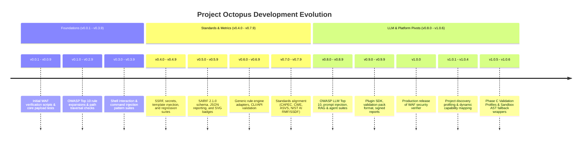

# HISTORY.md
## Phase 3 - Project Evolution & Version History

This document details the chronological evolution, version milestones, architectural pivots, and developmental progression of **Project Octopus** across its 106 version releases (`v0.0.1` through `v1.0.6`).

---

### 1. Evolutionary Timeline & Major Milestones

---

### 2. Version Phase Breakdown & Architectural Pivots

#### Phase I: Core Security Verification & Payload Expansion (`v0.0.1` - `v0.4.9`)
* **v0.0.1 - v0.0.9**: Established foundational python verification scripts evaluating WAF regex rules against command execution payloads.
* **v0.1.0 - v0.3.9**: Expanded security coverage to include SSRF, path traversal, Windows/Linux shell patterns, and sensitive info disclosure.
* **v0.4.0 - v0.4.9**: Introduced structured payload wrapping contexts (Markdown, HTML, JSON, YAML, CSV) to test payload behaviors inside different syntax boundaries.

#### Phase II: Enterprise Reporting Standards & Security Framework Alignment (`v0.5.0` - `v0.7.9`)
* **v0.5.0 - v0.5.9**: Added standardized SARIF 2.1.0 machine-readable output generation, coverage heatmaps, risk scoring, and SVG compliance badges.
* **v0.6.0 - v0.6.9**: Built CLI/API validation suites and parallel test execution capabilities.
* **v0.7.0 - v0.7.9**: Aligned verification taxonomies against formal standards: CAPEC, CWE, OWASP ASVS, NIST AI RMF, and NIST SSDF.

#### Phase III: LLM Safety, Plugin Architecture & Platform Agnosticism (`v0.8.0` - `v1.0.6`)
* **v0.8.0 - v0.8.9**: Integrated comprehensive AI agent safety testing covering the OWASP Top 10 for LLMs, prompt injection, RAG poisoning, tool invocation, and multi-agent interaction.
* **v0.9.0 - v0.9.9**: Introduced Plugin SDK, validation pack format (`.json`), signed reports (`v0.9.7`), and CI/CD GitHub Actions integration.
* **v1.0.0**: Milestone production release validating WAF security proxies across 4,494 test cases.
* **v1.0.1 - v1.0.4**: **Major Architectural Pivot**: Transitioned from a single-target WAF verifier to an agnostic repository profiling platform (`ProjectProfiler`), inferring target capabilities and building capability topology graphs.
* **v1.0.5 - v1.0.6**: **Current Release**: Introduced 8 fine-grained Validation Profiles (`generic`, `security_proxy`, `ai_agent`, `optimizer`, `dfir`, `cli`, `rest_api`, `plugin_framework`) and dynamic sandbox AST scanner fallback wrappers (`SandboxScannerWrapper`).
