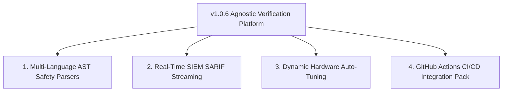

# NEXT_STEPS.md
## Phase 16 - Future Roadmap & Next Steps

This document outlines the evidence-grounded future development trajectory, feature roadmap, and expected impact for **Project Octopus** (`v1.0.6+`).

---

### 1. Evidence-Based Feature Roadmap

The following future directions are inferred strictly from existing code features, capability registries, and architecture gaps within the codebase:

---

### 2. Roadmap Items & Implementation Specifications

#### Item 1: Multi-Language AST Safety Parser Wrappers
* **Reason it Naturally Follows**: `SandboxScannerWrapper` is currently optimized for Python AST safety parsing (`analyze_code_safety`). Expanding wrappers to support JavaScript/TypeScript (via `esprima`) or C/C++ AST parsers enables AST-level security verification across multi-language repositories.
* **Expected Impact**: Extends fallback AST safety verification to full-stack web applications and native system tools.
* **Difficulty**: Medium.
* **Dependencies**: Node.js / Tree-Sitter AST parsing libraries.
* **Possible Risks**: Increased parser dependency footprint for non-Python targets.

#### Item 2: Real-Time SARIF 2.1.0 Stream Integration for Enterprise SIEMs
* **Reason it Naturally Follows**: `octopus_verifier.py` currently writes SARIF reports to disk upon execution completion. Streaming SARIF events over HTTP/gRPC as test suites complete enables real-time vulnerability monitoring in enterprise security operations centers.
* **Expected Impact**: Provides real-time DevSecOps feedback during long multi-profile verification runs.
* **Difficulty**: Medium.
* **Dependencies**: Python `requests` / gRPC client libraries.
* **Possible Risks**: Network latency overhead on remote SIEM endpoints.

#### Item 3: Dynamic Hardware Auto-Tuning Engine
* **Reason it Naturally Follows**: On resource-constrained edge hardware (e.g. mobile Termux/PRoot), running massive multi-profile runs can take tens of seconds. Auto-tuning dynamically adjusts syntax template counts based on available CPU cores and RAM.
* **Expected Impact**: Optimizes execution speed on low-power devices without sacrificing core security coverage.
* **Difficulty**: Low.
* **Dependencies**: `psutil` CPU/memory telemetry.
* **Possible Risks**: Minor reduction in syntax template variations on low-end hardware.

#### Item 4: Native GitHub Actions CI/CD Security Verification Pack
* **Reason it Naturally Follows**: Project Octopus outputs SARIF 2.1.0 schemas natively compatible with GitHub Code Scanning. Packaging `octopus_verifier.py` as a reusable GitHub Action (`v0.9.6`) enables zero-config pull request security gating.
* **Expected Impact**: Provides automated security compliance checks on every git push or pull request.
* **Difficulty**: Low.
* **Dependencies**: GitHub Actions runner environment / `action.yml`.
* **Possible Risks**: Runner timeout configuration on large multi-repository monorepos.
