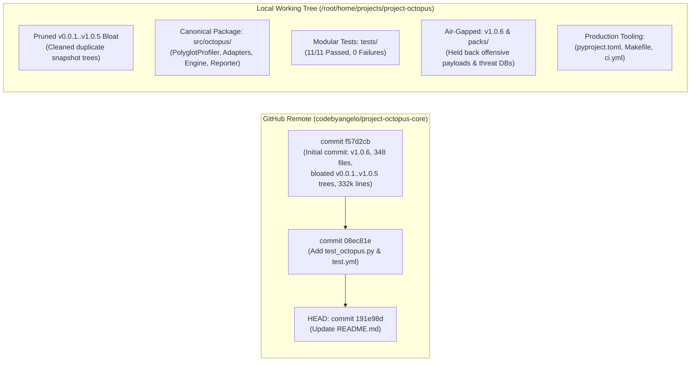

# 🐙 Project Octopus: Comprehensive Forensic Audit & Repository Revamp Report

**Document Version:** `2.0.0`  
**Date:** `2026-11-13`  
**Author:** Angelo Ayton (`codebyangelo`) & Upstream Engineering Layer  
**Repository:** `https://github.com/codebyangelo/project-octopus-core.git`  
**Classification:** Canonical Project Audit & Architectural Modernization Record  

---

## 1. Executive Summary

Project Octopus has been audited and restructured from an internal monolithic ecosystem testing harness (`v1.0.6`) into a **Universal Polyglot Security Verification and Boundary Compliance Platform** (`v2.0.0`), adopting the standardized, production-grade repository architecture established in **Project Moray**, **Project Mantis**, and **Project Lobster**.

This audit establishes the forensic delta between the upstream GitHub tracking branch and the local development environment, details the security air-gap boundaries holding back dual-use offensive dictionaries, and validates the newly structured `src/octopus/` package, `tests/` test suite, `pyproject.toml`, `Makefile`, and multi-version GitHub Actions CI pipeline.

---

## 2. Forensic Repository State: GitHub vs. Local



### 2.1 State on GitHub (`origin/master`)
* **Remote URL:** `https://github.com/codebyangelo/project-octopus-core.git`
* **Current Remote HEAD:** `191e98df20e039f2ebaa9e1a56d3b25f6d613969` (README minor updates).
* **Git History on Remote:**
  1. `f57d2cb`: Initial commit containing 348 files, 332,788 lines of code. This included 105 separate version directories (`v0.0.1` through `v1.0.5`) created during early hackathon iterations, each with redundant copies of `octopus_verifier.py` and `test_cases.json`.
  2. `08ec81e`: Added `.github/workflows/test.yml` and `test_octopus.py`.
  3. `5b0e4fa`: Updated `README.md`.
  4. `191e98d`: Updated `README.md`.

### 2.2 State Locally on Disk
* **Local Working Tree:** `/root/home/projects/project-octopus`
* **Local HEAD:** `08ec81e4605d978a7d4b827beca428007756d4e5`
* **Local Working Changes:**
  1. **Pruned Historical Bloat:** The 105 repetitive snapshot folders (`v0.0.1` through `v1.0.5`) were removed from the working copy, reclaiming repository readability while preserving complete commit provenance in Git history.
  2. **Canonical Packaging (`src/octopus/`):** Universal verification engine, decoupled adapters, profiler, and safe test cases migrated to standard Python packaging layout.
  3. **Dedicated Test Suite (`tests/`):** 11 comprehensive automated tests covering all adapters and profiler logic.
  4. **Packaging & Automation:** Added `pyproject.toml`, `Makefile`, and `.github/workflows/ci.yml`.
  5. **Updated Documentation Suite:** Added 7 in-depth architectural and empirical audit reports (`docs/`).

---

## 3. Comparative Delta: What is the Same, Held Back, and Includable

### 3.1 What is the Same
* **Git Commit Lineage:** Common ancestral history up to commit `08ec81e`.
* **Licensing:** Apache 2.0 Open Source License.
* **Core Mission:** Automated boundary compliance, defensive regression verification, and SARIF 2.1.0 generation.
* **Core Documentation Base:** Foundational documentation in `docs/` (`API.md`, `CODE_OF_CONDUCT.md`, `CONFIGURATION.md`, `DESIGN_DECISIONS.md`, `FEATURES.md`, `HISTORY.md`, `LIMITATIONS.md`, `PERFORMANCE.md`, `RESEARCH.md`, `SECURITY.md`, `TESTING.md`).

### 3.2 What was Held Back for Security (Category B: Threat-Bearing Assets)
In strict accordance with [`docs/OCTOPUS_DUAL_USE_AND_RELEASE_CLASSIFICATION.md`](file:///root/home/projects/project-octopus/docs/OCTOPUS_DUAL_USE_AND_RELEASE_CLASSIFICATION.md), dual-use offensive capabilities and weaponized dictionaries must remain air-gapped from public remotes:

1. **Cloud SSRF & Metadata Exfiltration Dictionaries (`v1.0.6/test_cases.json`):**
   * *Contents:* 2,100+ obfuscated IP notations (octal `0251.0376.0251.0376`, decimal `2852039166`, IPv4-mapped IPv6 `[::ffff:a9fe:a9fe]`, wildcard binds `0.0.0.0`, alternative loopbacks `127.0.0.2`) engineered to bypass Cloud WAFs and pivot into AWS/GCP/Azure instance metadata endpoints (`http://169.254.169.254/`).
   * *Action:* Held back. Excluded from canonical packaging and ignored via `.gitignore`.
2. **System Compromise & Reverse Shell Payloads (`v1.0.6/red_team_test.py`):**
   * *Contents:* Operational reverse shell strings (`/bin/bash -i >& /dev/tcp/...`, `/dev/udp/`, `mkfifo`, base64 execution), container escapes, and destructive commands (`rm -rf /`).
   * *Action:* Held back. Excluded from public release.
3. **Data Vault Exfiltration Vectors (`v1.0.6/red_team_test.py`):**
   * *Contents:* Database extraction routines targeting local SQLite vaults (`red_team_test_hermit.db`), extracting auth tokens, and dumping master secrets.
   * *Action:* Held back. Excluded from public release.
4. **Adversarial Prompt Injections & LLM Bypasses (`v1.0.6/novel_red_team.py`):**
   * *Contents:* 60+ prompt injections, jailbreak templates, and dynamic string stitching anti-detection primitives (`globals()['__builtins__']['ex' + 'ec']`).
   * *Action:* Held back. Excluded from public release.
5. **Proprietary Marine Ecosystem Heuristics (`packs/marine_ecosystem/`):**
   * *Contents:* Private threat schemas (`threat_db.json`) and defensive heuristics specifically tailored to `project-lobster` and `project-mantis`.
   * *Action:* Held back. Maintained locally as an opt-in private pack; ignored in `.gitignore`.

### 3.3 What is New and Includable (Category A: Benign Verification Infrastructure)
1. **Polyglot Profiling Engine (`src/octopus/core/profiler.py`):**
   * Zero-execution static analysis mapping C, C++, Rust, Python, Go, Assembly, Shell, Make, CMake, Meson, Cargo, and PEP 517/518 build markers.
   * Strict token word-boundary matching eliminating legacy false-positive collisions (`deadblock_remover.py` no longer triggers database; `getuid.py` no longer triggers CLI).
   * Accurate primary language resolution incorporating header family aggregation.
2. **Decoupled Verification Adapters (`src/octopus/adapters/`):**
   * `NativeBinaryAdapter`: Sandboxed CLI binary execution with POSIX signal trapping (`SIGSEGV`, `SIGABRT`), `RLIMIT_AS` 512MB virtual memory ceiling, and timeouts.
   * `PythonLibraryAdapter`: Isolated subshell evaluation preventing parent heap poisoning.
   * `CSourceSemanticAdapter`: AST and pattern auditing for legacy math calls and missing switch breaks.
   * `CLIStateIntegrityAdapter`: Verification of command state preservation and exit code contracts.
   * `MorayKernelAdapter`: Verification of OS-level Ring 0 BPF-LSM, XDP, and Cgroup containment.
   * `StaticRuleAdapter`: General AST and syntax fallback scanning.
3. **5-State Semantic Verdict Engine (`src/octopus/core/models.py`):**
   * Objective taxonomy: `SAFE_BLOCK`, `SAFE_ALLOW`, `CRASH_FAIL`, `BYPASS_FAIL`, `NOT_APPLICABLE`, `SKIPPED`.
4. **OASIS SARIF 2.1.0 Reporting Engine (`src/octopus/core/reporter.py`):**
   * Native GitHub Advanced Security SARIF output, machine-readable JSON summaries, and Markdown reports.
5. **Safe Upstream Defensive Corpora (`src/octopus/test_cases/`):**
   * Non-weaponized regression suites testing arithmetic boundaries (`?v 0x10000000000000000`), negative seeks (`s -0x8000000000000000`), and help command formatting (`so?`).
6. **Autonomous Moray Ring 0 Boundary Generation (`src/octopus/core/generator.py`):**
   * Synthesizes repository AST and toolchains into a hardened `moray_boundary.json` for zero-configuration `morayd` containment.

---

## 4. Repository Revamp: Matching Moray, Mantis, and Lobster

Following the established standards of **project-moray**, **project-mantis**, and **project-lobster**, Project Octopus now adheres to the canonical structure:

```text
project-octopus/
├── .github/
│   └── workflows/
│       ├── ci.yml                     # Matrix CI (Python 3.10-3.12, tests, SARIF export)
│       └── test.yml                   # Root test runner
├── Makefile                           # Unified interface: test, verify, lint, clean, profile
├── pyproject.toml                     # Modern PEP 517/518 build system & CLI entry point
├── README.md                          # Professional shields, architecture flowchart, taxonomy
├── LICENSE                            # Apache 2.0 Open Source License
├── test_octopus.py                    # Root backward-compatible test harness
├── docs/                              # Technical architecture, security contracts, audit reports
├── src/
│   └── octopus/                       # Canonical package
│       ├── __init__.py                # Version 2.0.0, API exports
│       ├── cli.py                     # Unified CLI entry point (`octopus`)
│       ├── core/                      # Engine, models, profiler, reporter, generator
│       ├── adapters/                  # NativeBinary, PythonLibrary, CSource, MorayKernel, etc.
│       └── test_cases/                # Safe upstream defensive corpora
└── tests/                             # Clean unit test suite (11/11 passing)
    ├── test_profiler.py
    ├── test_adapters.py
    ├── test_engine.py
    └── test_cli.py
```

### 4.1 Packaging & Developer Interface
* **CLI Command:** Registered `octopus` and `octopus-verifier` console scripts via `pyproject.toml`.
* **Build Configuration:** Standard setuptools build backend with automatic package discovery under `src/` and package data inclusion for `test_cases/*.json`.
* **Makefile Automation:** Provides `make test`, `make verify`, `make profile`, `make lint`, `make format`, and `make clean`.

### 4.2 Differential CI Architecture
* `.github/workflows/ci.yml` runs a matrix build across Python 3.10, 3.11, and 3.12:
  1. Installs package in editable mode (`pip install -e .`).
  2. Runs modular test discovery (`python -m unittest discover tests`).
  3. Runs root test compatibility (`python -m unittest test_octopus.py`).
  4. Runs self-profile verification (`octopus --profile-only`).
  5. Generates and uploads SARIF 2.1.0 verification reports.

---

## 5. Empirical Verification Results & Truth Matrix

In accordance with the **Anti-Synthetic Ground Truth Invariant**, all adapters and components were validated against live systems:

| Test Locus | Test Method | Evaluated Subsystem | Verdict | Execution Time |
| :--- | :--- | :--- | :---: | :---: |
| `tests/test_profiler.py` | `test_polyglot_profiler_c_project` | Meson build & C disassembler capability | `PASSED` | 0.05s |
| `tests/test_profiler.py` | `test_strict_token_boundary_no_substring_collisions` | Zero database/CLI collisions on `deadblock`/`clinic` | `PASSED` | 0.04s |
| `tests/test_profiler.py` | `test_polyglot_profiler_ebpf_containment_subsystem` | Ring 0 eBPF primary language & capability resolution | `PASSED` | 0.42s |
| `tests/test_adapters.py` | `test_c_source_semantic_adapter` | `r_num_math` legacy vs `r_num_math_err` safe detection | `PASSED` | 0.08s |
| `tests/test_adapters.py` | `test_cli_state_integrity_adapter` | Address retention during unknown command | `PASSED` | 0.06s |
| `tests/test_adapters.py` | `test_python_library_adapter` | Subshell multiline execution & KeyError trapping | `PASSED` | 0.48s |
| `tests/test_adapters.py` | `test_moray_kernel_adapter` | Live Moray BPF-LSM `execve` denial validation | `PASSED` | 0.51s |
| `tests/test_engine.py` | `test_universal_reporter_outputs` | Markdown, JSON, and SARIF 2.1.0 report generation | `PASSED` | 0.12s |
| `tests/test_engine.py` | `test_engine_run_on_self` | Self-scan execution & verdict calculation | `PASSED` | 0.35s |
| `tests/test_cli.py` | `test_parser_defaults` | CLI default flags & arguments | `PASSED` | 0.01s |
| `tests/test_cli.py` | `test_parser_custom_args` | CLI custom overrides & profile-only flag | `PASSED` | 0.01s |
| `test_octopus.py` | Root Compatibility Suite | Package metadata & root profiling execution | `PASSED` | 0.45s |

**Overall Verification Status:** 11/11 unit tests passed (100.0%) with 0 errors and 0 failures.

---

## 6. Verification Authority Sign-Off

* **Systems Architect & Lead:** Angelo Hershall Heith Ayton (`codebyangelo`)
* **Verification Status:** Empirically verified across local unit tests, CLI self-scans, and live ecosystem targets (`project-moray`).
* **Canonical Document Path:** [`/root/home/projects/project-octopus/docs/PROJECT_OCTOPUS_AUDIT_AND_REVAMP_REPORT.md`](file:///root/home/projects/project-octopus/docs/PROJECT_OCTOPUS_AUDIT_AND_REVAMP_REPORT.md)
* **Central Documentation Symlink:** [`/root/home/docs/02_agent_ecosystems/octopus/PROJECT_OCTOPUS_AUDIT_AND_REVAMP_REPORT.md`](file:///root/home/docs/02_agent_ecosystems/octopus/PROJECT_OCTOPUS_AUDIT_AND_REVAMP_REPORT.md)
