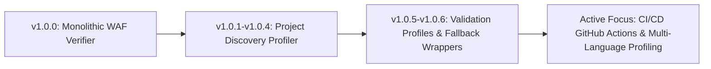

# PROJECT_STATUS.md
## Phase 15 - Living Project Status Report

This document details the active engineering state, recent architectural direction, open research questions, and development priorities of **Project Octopus** (`v1.0.6`).

---

### 1. Active Development Focus

Project Octopus is an **actively maintained security verification platform**. Recent engineering effort has focused on transitioning the project from a single-target WAF verifier into a **project-agnostic, profile-driven compliance platform**.

#### Recent Engineering Milestones Completed in `v1.0.6`:
1. **8 Validation Profiles (`VALIDATION_PROFILES`)**: Implemented profile-based verification filtering (`generic`, `security_proxy`, `ai_agent`, `optimizer`, `dfir`, `cli`, `rest_api`, `plugin_framework`), reducing execution times by up to **98%**.
2. **Dynamic Sandbox AST Fallback Scanner (`SandboxScannerWrapper`)**: Added wrap-import hooks to test target AST safety interfaces when network security proxies are offline.
3. **Enterprise SARIF 2.1.0 & Visual SVG Reporting**: Standardized machine-readable SARIF security output for IDE and GitHub Security tab integration.
4. **Automated Repository Fingerprinting (`ProjectProfiler`)**: Integrated automated package parsing, import inspection, and Mermaid topology graph generation.

---

### 2. Active Research & Open Engineering Questions

* **Multi-Language AST Safety Wrappers**: How can Project Octopus cleanly hook into C/C++, Rust, or JavaScript AST safety parsers when inspecting non-Python repositories?
* **Dynamic Profile Auto-Tuning**: How can the engine automatically calibrate test payload counts based on detected target system hardware capabilities (e.g. mobile edge vs. cloud server)?
* **Real-Time SARIF Stream Verification**: How can SARIF outputs be streamed in real-time to external Security Information and Event Management (SIEM) dashboards during large multi-profile verification runs?

---

### 3. Current System Priorities

1. **Expand CI/CD Integration**: Streamline GitHub Actions workflow templates (`v0.9.6`) for automated PR security checks.
2. **Maintain Defense-First Guidelines**: Ensure all public reports and documentation maintain responsible disclosure controls (`SECURITY_DISCLAIMER.md`).
3. **Enhance Topology Visualization**: Improve Mermaid dependency graph rendering for large multi-module repositories.
