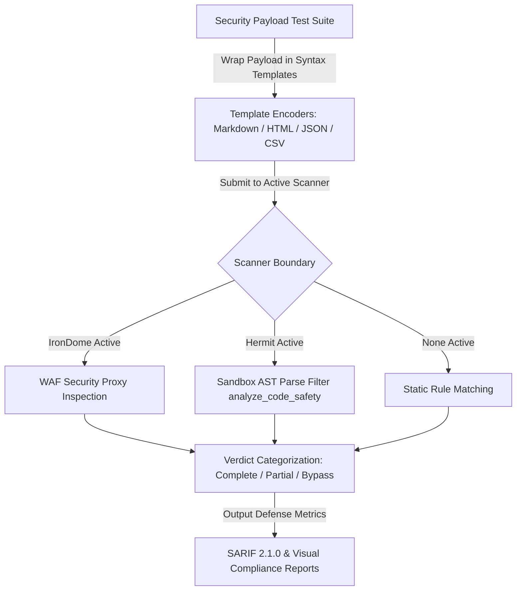

# SECURITY.md
## Phase 10 - Security Architecture & Defense-First Boundary Model

This document outlines the security architecture, threat model, defense-first design boundaries, responsible disclosure policies, and SARIF 2.1.0 compliance modeling in **Project Octopus** (`v1.0.6`).

---

### 1. Threat Model & Verification Scope Boundaries

Project Octopus operates exclusively as a **defensive security verifier and compliance profiling platform**. Its architecture is engineered to evaluate software targets without exposing actionable exploit material to threat actors.

#### Identified Threat Vectors & Defensive Mitigations:

1. **Information Leakage to Threat Actors**:
   * *Threat*: Detailed security reports or test suites reveal actionable exploit vectors or bypass signatures that malicious actors could use to circumvent security proxies.
   * *Mitigation*: **High-Level Taxonomy Abstraction & Responsible Disclosure**. Test suites use standard security taxonomies (CWE, CAPEC, OWASP Top 10 for LLMs, MITRE ATT&CK). High-level documentation omits actionable exploit payloads, focusing on validation profile coverage and compliance reporting (`SECURITY_DISCLAIMER.md`).

2. **Unsafe Payload Execution During Verification**:
   * *Threat*: Executing verification test payloads against local target directories triggers unintended system command execution (`os.system`) or file modifications.
   * *Mitigation*: **Parse-Time AST Verification (`SandboxScannerWrapper`)**. Payloads are evaluated at the AST parse level (`analyze_code_safety`) inside isolated child processes, preventing payload execution on the host machine.

3. **Report Outcome Spoofing / Tampering**:
   * *Threat*: A malicious target or corrupted test run manipulates verification reports to fake compliance.
   * *Mitigation*: **SARIF 2.1.0 Cryptographic Integrity & Version Comparators**. Output reports include cryptographic hashes (`v0.9.7: Signed Reports`) and standardized SARIF schemas that are validated by enterprise CI/CD runners.

---

### 2. Standardized Taxonomy Mapping

Project Octopus maps verification results against formal security standards:

* **OWASP Top 10 for LLMs**: LLM01 (Prompt Injection) through LLM10 (Model Theft).
* **MITRE ATT&CK Framework**: Tactics including Initial Access, Execution, Persistence, Privilege Escalation, Defense Evasion, Credential Access, Discovery, Lateral Movement, Collection, and Exfiltration.
* **Standards Alignment**: CAPEC, CWE, OWASP ASVS, NIST AI RMF, and NIST SSDF.
