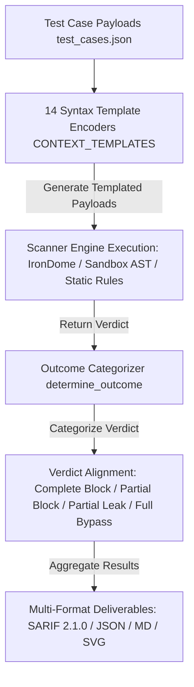

# TESTING.md
## Phase 12 - Testing Strategy & Verification Framework

This document details the testing methodology, regression verification suites, syntax template wrapping, and quality assurance framework in **Project Octopus** (`v1.0.6`).

---

### 1. Verification Strategy & Architecture

Project Octopus employs a multi-layered verification framework to evaluate software security compliance without requiring target binary modification:



---

### 2. Syntax Template Encoders (`CONTEXT_TEMPLATES`)

To ensure security controls block threats regardless of how payload text is formatted or embedded inside user inputs, Octopus wraps test payloads in 14 distinct syntax templates:

| Template Name | Enclosing Syntax Format | Purpose |
| :--- | :--- | :--- |
| **Raw** | Direct payload string | Evaluates raw unformatted payload behavior |
| **Markdown (Fenced)** | ` ```python\n<payload>\n``` ` | Evaluates code blocks inside markdown notes |
| **Markdown (Inline)** | `` `<payload>` `` | Evaluates inline code backticks |
| **Markdown (Link)** | `[link](<payload>)` | Evaluates URL link targets |
| **HTML (Div)** | `<div><pre><payload></pre></div>` | Evaluates HTML preformatted text blocks |
| **HTML (Attribute)** | `<input value="<payload>">` | Evaluates HTML attribute value injection |
| **HTML (Comment)** | `<!-- <payload> -->` | Evaluates HTML comment boundaries |
| **JSON** | `{"request": {"code": "<payload>"}}` | Evaluates JSON API request payloads |
| **YAML** | `request:\n  payload: | <payload>` | Evaluates YAML multi-line block payloads |
| **XML (CDATA)** | `<payload><![CDATA[<payload>]]></payload>` | Evaluates XML CDATA escape boundaries |
| **CSV** | `id,snippet\n1,"<payload>"` | Evaluates CSV cell value boundaries |
| **Source (Comment)** | `# <payload>` | Evaluates Python comment boundaries |
| **Source (String)** | `exploit = """<payload>"""` | Evaluates Python multi-line string assignments |
| **Source (Function)**| `def verify():\n  <payload>` | Evaluates Python function definition bodies |

---

### 3. Verdict Categorization & Outcome Confidence

`determine_outcome` evaluates test verdicts against taxonomy suite names to categorize outcomes into four confidence states:

1. **Complete Block**: Payload blocked by category-aligned security rules (e.g., SSRF payload blocked by a network security rule).
2. **Partial Block**: Payload blocked, but by generic or unrelated rule matches.
3. **Partial Leak**: Payload allowed execution, but encountered system warnings or API errors.
4. **Full Bypass**: Payload allowed execution cleanly without triggering security alarms.
