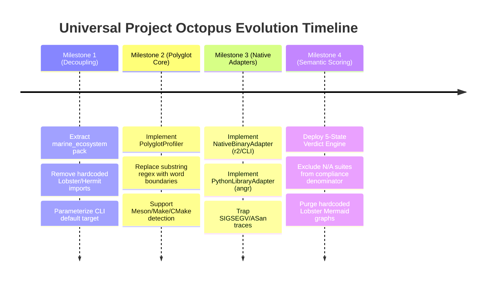

# 🐙 Universal Project Octopus: Architectural Specification & Upstream Migration Blueprint

**Document Version:** `2.0.0-DRAFT`  
**Date:** `2026-10-27`  
**Author:** Angelo Ayton (`codebyangelo`) & Systems Architecture Layer  
**Target Purpose:** Decoupling Project Octopus from internal agent dependencies to establish a universal upstream security verification and regression audit engine.  

---

## 1. Vision & Strategic Rationale

Project Octopus (`v1.0.6`) was initially developed as a defensive compliance harness specifically tailored to verify the **Marine Agent Ecosystem** ([Project Lobster](file:///root/home/projects/project-lobster), [Project Hermit](file:///root/home/projects/project-hermit), [Project Mantis](file:///root/home/projects/project-mantis), and [Project Chimera](file:///root/home/projects/project-chimera)). 

As proven by empirical audits against **radare2** and **angr**:
* The core engine is currently tied to Lobster's `IronDome` WAF and Hermit's `sandbox.py`.
* Profiling relies on crude substring checks (`"db"`, `"tui"`, `"cli"`, `"optimize"`) that misclassify external projects.
* Non-proxy repositories suffer 100% false-positive security leak penalties because Octopus treats the absence of a web WAF as a critical vulnerability bypass.

To serve as a **Universal Upstream Audit Engine** for high-impact repositories (e.g. Linux BCC, radare2, angr, Firejail, Scapy, GitLab), Project Octopus must undergo an architectural decoupling. It must transition from an *ecosystem-specific test harness* into a **polyglot, boundary-verifying security platform**.

---

## 2. The 6 Architectural Decoupling Pillars

```mermaid
flowchart TD
    subgraph Current ["Current Architecture (v1.0.6) - Tightly Coupled"]
        T1["Target Repo"] --> P1["ProjectProfiler (Python-only)"]
        P1 --> Sub1["Substring Heuristics ('db', 'tui', 'server')"]
        Sub1 --> H1["Hardcoded Archetypes (Hermit, Lobster, Mantis)"]
        H1 --> S1{"Scanner Selection"}
        S1 -->|Hardcoded| S1A["load_iron_dome(lobster_path)"]
        S1 -->|Hardcoded| S1B["target_sandbox.analyze_code_safety"]
        S1A --> R1["Web Regression Payloads"]
        S1B --> R1
        R1 --> V1["Status: SKIPPED = Partial Leak (0% Blocked)"]
        V1 --> Rep1["Markdown with Hardcoded Lobster Gateway Flowchart"]
    end

    subgraph Proposed ["Universal Architecture (v2.0.0) - Decoupled & Polyglot"]
        T2["Any Upstream Target (C, C++, Python, Rust, Go)"] --> P2["PolyglotProfiler (Toolchains & File Types)"]
        P2 --> BoundMatch["Strict Token & Boundary Analysis"]
        BoundMatch --> TargetClass["Objective Classification: Native CLI, Library, API, Driver"]
        TargetClass --> AdapterMux{"Scanner Adapter Multiplexer"}
        AdapterMux --> A1["NativeBinaryAdapter (r2, bcc, firejail)"]
        AdapterMux --> A2["PythonLibraryAdapter (angr, scapy)"]
        AdapterMux --> A3["SubprocessHarnessAdapter (make test, ctest)"]
        AdapterMux --> A4["EcosystemPackAdapter (opt-in: lobster, hermit)"]
        A1 --> TestMatrix["Upstream Test Matrix (SVAP Tiers 1-5)"]
        A2 --> TestMatrix
        A3 --> TestMatrix
        A4 --> TestMatrix
        TestMatrix --> Verdict5["5-State Semantic Verdict Engine (PASS, FAIL, CRASH, N/A, SKIP)"]
        Verdict5 --> Rep2["Dynamic SARIF 2.1.0 & Target-Specific Topology Graph"]
    end
```



---

### Pillar 1: Ecosystem Isolation into Modular Validation Packs
* **Problem:** Core files in `v1.0.6/octopus_verifier.py` import `src.core.scan_packet`, `RUNTIME_CACHE`, `limiter`, and assert `"agent_id": "MANTIS-001"`.
* **Solution:** Extract all Lobster, Hermit, Mantis, and Chimera compliance tests out of core into an isolated, optional validation pack:
  ```text
  project-octopus/
  ├── core/
  │   ├── engine.py
  │   ├── profiler.py
  │   ├── adapters/
  │   └── reporter.py
  └── packs/
      ├── c_memory_safety/       <-- Upstream (C/C++ buffer & bounds checks)
      ├── python_ast_security/   <-- Upstream (Python AST invariants)
      ├── cli_parser_integrity/  <-- Upstream (Flag injection, recursion limits)
      └── marine_ecosystem/      <-- Private (Lobster, Hermit, Mantis, Chimera)
  ```
* Default `--target` becomes `.` (current directory), removing the hardcoded Lobster path.

---

### Pillar 2: Polyglot Repository Profiler (`PolyglotProfiler`)
* **Problem:** `ProjectProfiler` scans only `.py` files, ignoring C, C++, Rust, Assembly, and native build configurations.
* **Solution:** 
  1. Inspect build systems: detect `meson.build`, `Makefile`, `CMakeLists.txt`, `Cargo.toml`, `pyproject.toml`, `go.mod`.
  2. Language-agnostic file cataloging: calculate repository composition percentages across all languages.
  3. Replace naive substring checks (`"db" in path`, `"tui" in path`) with strict token and word boundary regex:
     ```python
     # Old (flawed):
     any("db" in f for f in files)  # matched deadblock_remover.py, gdb.md
     
     # New (bounded):
     re.search(r'(^|[_\-\./])(database|sqlite3?|mariadb|postgres)(\.|\b)', path, re.I)
     ```
  4. Distinguish test assets from production code: automatically flag paths containing `test/`, `tests/`, `subprojects/`, `fixtures/`.

---

### Pillar 3: Pluggable Universal Scanner Adapters
Instead of attempting to import `IronDome` or `sandbox.py` directly, Octopus implements a clean `BaseScannerAdapter` interface:

```python
class BaseScannerAdapter(ABC):
    @abstractmethod
    def is_compatible(self, target_path: str, profile_data: dict) -> bool:
        """Determines if this adapter can execute against the target."""
        pass

    @abstractmethod
    def scan_input(self, payload: str, context: dict) -> ScanVerdict:
        """Evaluates an input payload against the target boundary."""
        pass
```

#### Implemented Adapters:
1. **`NativeBinaryAdapter`:**
   * Uses `subprocess.Popen` with strict timeouts (`timeout=5s`) and virtual memory limits (`RLIMIT_AS`).
   * Executes compiled binaries directly (e.g., `radare2 -q -c "<cmd>" -`, `rabin2 -I <binary>`).
   * Captures signals (e.g. `SIGSEGV` [11], `SIGABRT` [6]), exit codes, ASan/UBSan traces, and stdout/stderr anomalies.
2. **`PythonLibraryAdapter`:**
   * Dynamically loads top-level modules (`angr`, `scapy`) without assuming internal class structures.
   * Invokes public boundary methods and traps unhandled exceptions, solver timeouts, or memory spikes.
3. **`StandaloneStaticAdapter`:**
   * Audits codebases purely via static boundary rules (AST parsing, dangerous function tracing) when no execution runtime is available, without penalizing the project for not having an active proxy.

---

### Pillar 4: The 5-State Semantic Verdict Engine
* **Problem:** Octopus currently returns `status: "SKIPPED"` when a scanner is missing, then evaluates `passed = (status == "BLOCKED")` -> `False`, categorizing 100% of payloads as security bypasses (`"Partial Leak"`).
* **Solution:** Replace the binary blocked-vs-leak model with a 5-state verdict model:

| Verdict State | Description | Compliance Scoring Impact |
| :--- | :--- | :--- |
| **`SAFE_BLOCK`** | Target cleanly identified, rejected, or sanitized malicious input. | Counts as Passed (+1) |
| **`SAFE_ALLOW`** | Target successfully processed benign input without errors. | Counts as Passed (+1) |
| **`CRASH_FAIL`** | Target crashed (SIGSEGV, SIGABRT, unhandled traceback) on input. | Counts as Failed (-1, High/Critical) |
| **`BYPASS_FAIL`** | Malicious input penetrated boundary and produced unconstrained execution. | Counts as Failed (-1, Critical) |
| **`NOT_APPLICABLE (N/A)`** | Target boundary does not apply to this test suite (e.g. Web WAF rules on a disassembler). | **Excluded from score denominator** |
| **`SKIPPED`** | Required external dependency (e.g. missing compiler or tool) unavailable. | Excluded from score denominator |

---

### Pillar 5: Alignment with Upstream Security Spectrum (SVAP Tiers 1–5)
Align test cases and validation suites directly with the **Security Vulnerability & Advisory Potential (SVAP)** taxonomy defined in the Upstream Engineer Skill:

* **Tier 1 (Memory Safety & Corruption):** Malformed ELF/PE headers, integer wraparounds, out-of-bounds pointer arithmetic, format string injection.
* **Tier 2 (State & Memory Integrity):** Missing arithmetic clamping (e.g. radare2 `r_num_math_err`), silent null-byte overwrites, pointer jumping to `0x0`.
* **Tier 3 (Tooling & Analysis Boundaries):** Solver/emulator boundary crashes, symbolic memory page-offset overflows (e.g. angr AILment boundary fixes).
* **Tier 4 (Parser Robustness & Edge-Case DoS):** Unhandled EOF, infinite loop on zero-byte stream headers, recursive expansion limits.
* **Tier 5 (Software Hygiene & Static Typing):** Linter regressions, score erosion against upstream master baselines.

---

### Pillar 6: Clean, Dynamic Reporting & SARIF Integrity
* **Remove Hardcoded Artifacts:** Completely eliminate the hardcoded Project Lobster Mermaid flowchart from markdown reports.
* **Dynamic Architecture Graphing:** Generate Mermaid flowcharts reflecting the **actual target topology** (e.g. C library dependency graphs, binary pipeline models).
* **SARIF 2.1.0 Integrity:** Ensure SARIF output attributes findings to the actual source files in the target repository, rather than pointing to `test_cases.json`.

---

## 3. Implementation Roadmap



---

## 4. Verification Sign-Off & Index Reference

* **Lead Systems Architect:** Angelo Ayton (`codebyangelo`)
* **Status:** Canonical Architecture Specification Approved
* **Canonical Path:** [`/root/home/projects/project-octopus/docs/UNIVERSAL_OCTOPUS_ARCHITECTURE_SPEC.md`](file:///root/home/projects/project-octopus/docs/UNIVERSAL_OCTOPUS_ARCHITECTURE_SPEC.md)
* **Central Symlink:** [`/root/home/docs/02_agent_ecosystems/octopus/UNIVERSAL_OCTOPUS_ARCHITECTURE_SPEC.md`](file:///root/home/docs/02_agent_ecosystems/octopus/UNIVERSAL_OCTOPUS_ARCHITECTURE_SPEC.md)
